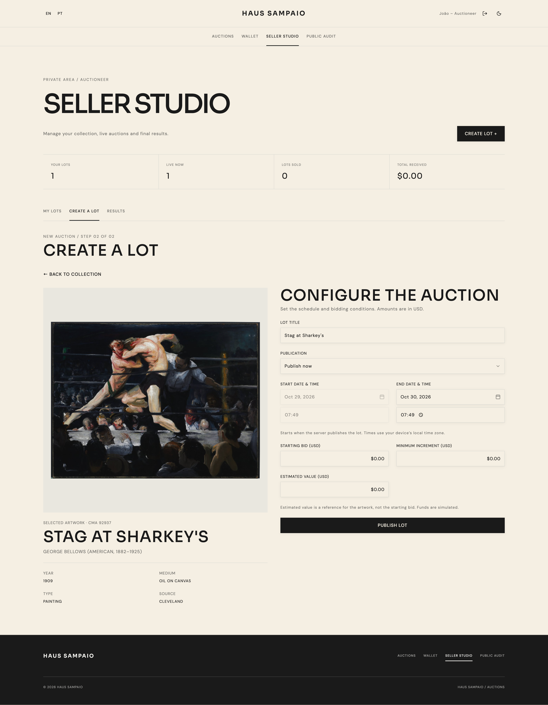

# HAUS SAMPAIO

Casa de leilões de arte com catálogo do Cleveland Museum of Art, lances em tempo real, carteira simulada e auditoria pública. Leiloeiros publicam obras; licitantes disputam lotes com saldo reservado até o encerramento.

[Aplicação](https://elite-dev-verzel-delta.vercel.app/) · [API — saúde](https://elite-dev-verzel-2c5n.onrender.com/health) · [Repositório](https://github.com/gadielsampaio/elite-dev-verzel)

## Acesso em produção

**Aplicação:** https://elite-dev-verzel-delta.vercel.app/

**Login:** https://elite-dev-verzel-delta.vercel.app/#/login

| Pessoa | Papel | E-mail |
| --- | --- | --- |
| João | Leiloeiro | `joao@mail.com` |
| Pedro | Licitante | `pedro@mail.com` |
| Tiago | Licitante | `tiago@mail.com` |

**Senha para as três contas: `12345678`.** São contas de demonstração; depósitos e pagamentos são simulados.

## Funcionalidades

- Vitrine de lotes ao vivo, agendados e encerrados; cancelados ficam fora da listagem pública.
- Seller Studio: busca por obra/artista e categoria, publicação imediata ou agendada, cancelamento antes de qualquer lance e resultados do vendedor.
- Sala com visualização 3D, zoom, histórico, posição do licitante e atualizações por WebSocket.
- Carteira com depósitos simulados e saldos total, comprometido e disponível.
- Lances com incremento mínimo, reserva/liberação de saldo e prorrogação de dois minutos no fim da disputa.
- Liquidação automática, participações, arremates e comprovante acessível ao vencedor e ao leiloeiro.
- Auditoria pública com identificação pseudônima e verificação do histórico.
- Cadastro, login, renovação por cookie HttpOnly, temas claro/escuro e interface em português/inglês.

## Tecnologias e organização

React, TypeScript, Vite, shadcn/ui e Tailwind no frontend; NestJS com ESM, Prisma 7, PostgreSQL e Socket.IO no backend. Docker Compose reúne os três serviços locais. Vitest, Playwright e Oxlint cobrem testes e análise de código.

| Diretório | Conteúdo |
| --- | --- |
| `frontend/src/haus/app/` | Páginas, componentes de domínio, tema e layout |
| `frontend/src/haus/data/` | Consultas HTTP, ações e atualização por eventos |
| `frontend/src/components/ui/` | Componentes de interface compartilhados |
| `backend/src/` | Módulos de autenticação, catálogo, lotes, lances, carteira, liquidação e auditoria |
| `backend/prisma/` | Schema, migrations e seeds por entidade |
| `docs/` | [Arquitetura e ideias](docs/architecture.md), [banco de dados](docs/database.md) e Postman |

## Executar localmente

Requer Docker com Docker Compose. Para comandos fora dos containers, use Node.js 24 e npm. Execute os passos abaixo na raiz do repositório.

### 1. Configurar o ambiente

Em um checkout novo:

```sh
git clone https://github.com/gadielsampaio/elite-dev-verzel.git
cd elite-dev-verzel
cp .env.example .env
openssl rand -hex 32
```

Copie o valor gerado para `JWT_SECRET` no `.env`. Configure `POSTGRES_USER`, `POSTGRES_PASSWORD` e `POSTGRES_DB`; os valores de desenvolvimento do exemplo podem ser usados localmente. Preserve um `.env` já configurado.

O Compose monta `DATABASE_URL` automaticamente. Use credenciais locais sem caracteres reservados de URL. `CATALOG_PROVIDER=cleveland` consulta o museu; `mock` utiliza fixtures explícitas, sem fallback automático. Não é necessária chave para o catálogo.

### 2. Criar as tabelas e iniciar

```sh
docker compose up -d db
docker compose run --build --rm api npx prisma migrate deploy --config prisma7.config.ts
docker compose up -d --build
docker compose exec -e SEED_PASSWORD=12345678 api npm run db:seed
```

O startup da API gera o Prisma Client. Migrations e seeds são explícitos; não são executados automaticamente no ambiente local.

| Serviço | Endereço |
| --- | --- |
| Frontend | http://127.0.0.1:5175 |
| API | http://localhost:3000 |
| PostgreSQL | `127.0.0.1:5432`, com os dados do `.env` |

### 3. Experimentar o fluxo

O comando de seed acima cria as mesmas contas de demonstração listadas em [Acesso em produção](#acesso-em-produção).

O seed cria apenas as três contas e suas carteiras vazias. Os lotes são publicados manualmente pelo leiloeiro no Seller Studio; não há lances nem créditos artificiais. Os dados ficam nos [JSONs de seed](backend/prisma/seeds/data/).

1. Entre como João no Seller Studio, selecione uma obra e publique um lote com início imediato, prazo futuro, lance inicial e incremento mínimo.
2. Em sessões de navegador separadas, entre como Pedro e Tiago, faça depósitos simulados e dispute o lote.
3. Após o encerramento e a liquidação, confira os saldos, o resultado e o comprovante. A auditoria pode ser aberta sem login.

Rodar o seed novamente não apaga dados, não troca senhas existentes e não altera lotes. Para uma nova disputa, publique outro lote pelo painel.

### Manutenção local

```sh
docker compose ps
docker compose logs --tail=100 api db
docker compose exec api npx prisma migrate status --config prisma7.config.ts
docker compose exec api npx prisma migrate deploy --config prisma7.config.ts
docker compose exec api npx prisma generate --config prisma7.config.ts
docker compose exec db sh -c 'psql -U "$POSTGRES_USER" -d "$POSTGRES_DB"'
docker compose stop
```

O volume `postgres_data` preserva os dados. Não use `docker compose down -v` para apenas parar o projeto. Alterar credenciais no `.env` não altera um banco já inicializado. Os checkpoints locais de auditoria ficam em `.local/audit-checkpoints/`; preserve-os junto com o banco.

Para editar o frontend fora do Docker: pare `web`, entre em `frontend/`, copie `.env.example` para `.env`, execute `npm ci` e `npm run dev`. Para o backend no host, configure `backend/.env` pelo exemplo, usando `localhost` no `DATABASE_URL`; pare a API Docker antes de iniciar ou compilar a API no host, pois compartilham `dist`.

## API e Postman

Importe a [coleção](docs/postman/Auction%20API.postman_collection.json) e o [ambiente local](docs/postman/Auction%20API%20Local.postman_environment.json). Selecione o ambiente com `baseUrl=http://localhost:3000`.

`GET /health` executa `SELECT 1`. Com PostgreSQL acessível, retorna HTTP 200:

```json
{"status":"ok","services":{"api":"up","database":"up"}}
```

Sem conexão com o banco, retorna HTTP 503 com `status: "error"` e `database: "down"`. Isso não verifica se as migrations foram aplicadas. `GET /health/external` verifica o catálogo separadamente.

Rotas protegidas usam `Authorization: Bearer <accessToken>`. Login, renovação e logout também exigem `X-Session-Request: 1`; o refresh token fica em cookie HttpOnly. A aplicação envia esses dados automaticamente.

## Testes

Com os containers iniciados:

```sh
docker compose exec api npm run build
docker compose exec api npm run lint
docker compose exec api npm test
docker compose exec api npm run test:e2e
docker compose exec web npm run build
```

Os testes de banco são opt-in. Execute apenas no ambiente local, de forma sequencial:

```sh
docker compose exec -e RUN_DATABASE_TESTS=1 api npm run test:e2e -- --no-file-parallelism
```

Para os testes de navegador, no host:

```sh
cd frontend
npm ci
npx playwright install chromium
npm run test:e2e
```

A suíte padrão de navegador simula respostas da API. Os testes `live-bidding.spec.ts` e `refresh-live.spec.ts` são separados, ativados por `RUN_LIVE_TESTS=1`, e precisam da API local e do `backend/.env` configurado; não devem apontar para produção.

## Deploy

O frontend está na Vercel; a API e o PostgreSQL, no Render. No Render, configure `DATABASE_URL`, `JWT_SECRET`, `CATALOG_PROVIDER=cleveland` e `CORS_ORIGINS` com a origem exata do frontend. Use `backend/` como raiz e `npm run start:render` como comando Docker: aplica migrations, gera o client, compila e inicia a API.

Na Vercel, use `frontend/`, build `npm run build`, saída `dist`, `VITE_API_BASE_URL=/api` e `VITE_SOCKET_BASE_URL=https://elite-dev-verzel-2c5n.onrender.com`. O [vercel.json](frontend/vercel.json) encaminha HTTP ao backend; Socket.IO conecta diretamente. Em outro deploy, atualize também esse destino. Mantenha cookies Secure em produção; o Compose já configura a exceção para HTTP local.

O script `npm run db:remote --prefix backend -- --check` valida `REMOTE_DATABASE_URL` e `SEED_PASSWORD` do `.env` raiz sem escrever. Sem `--check`, aplica migrations e seeds; `--migrate-only` aplica apenas migrations. Ele não limpa o banco. Variáveis `VITE_*` são públicas: não coloque senhas ou URLs de banco nelas.

## Comportamentos conhecidos e limitações

- **Vitrine vazia:** o seed não publica lotes. Crie pelo menos um lote aberto no Seller Studio para disponibilizar a demonstração de lances.
- **Catálogo:** o Adapter normaliza o Cleveland. Lotes publicados guardam os dados da obra, então consultas e operações não precisam chamar o catálogo novamente. As imagens ainda dependem do CDN do museu; indisponibilidade pode impedir sua exibição.
- **Dinheiro:** depósitos são simulados, sem gateway de pagamento. Saldo deriva do extrato e das reservas, com operações críticas em transações. Cancelamento com lances não está disponível.
- **Encerramento:** o worker verifica lotes a cada dez segundos enquanto a API está ativa. Pode haver intervalo entre o fim da disputa e a confirmação do resultado; não há lances aceitos após o prazo.
- **Auditoria:** snapshots SHA-256 encadeados são comparados com histórico suplementar alimentado por triggers. Isso detecta alterações diretas no histórico sob as proteções descritas em [arquitetura](docs/architecture.md). Não garante integridade contra um administrador que desative essas proteções ou reescreva toda a evidência. Histórico vazio ou sem cobertura não é certificado como íntegro.
- **Acesso:** auditoria é pública; comprovantes exigem login do vencedor ou leiloeiro, mesmo quando o link é compartilhado.
- **Tempo real:** os eventos são locais ao processo, sem broker distribuído. Reconexão e consultas HTTP recuperam o estado; executar múltiplas instâncias exige coordenação adicional.
- **Validação:** fluxos completos de lances/liquidação foram verificados localmente. Após o último reset, saúde e logins foram verificados em produção; o fluxo completo de produção ainda precisa ser reexecutado.

## Capturas de tela

### Vitrine — tema escuro


### Seller Studio — coleção


### Publicação de lote



### Sala de leilão


